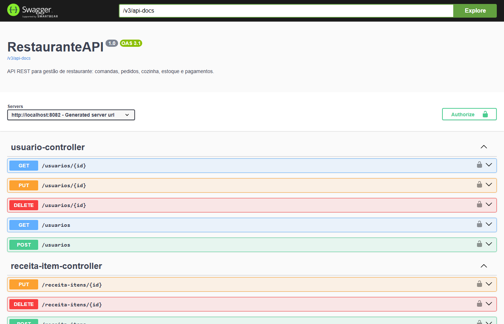
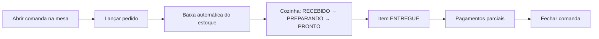

# RestauranteAPI

API REST para gestão de restaurante: da abertura da comanda na mesa ao fechamento da conta, passando pela cozinha, pelo controle de estoque por ficha técnica e pelos pagamentos.


<!-- TODO: salve um print do Swagger em docs/swagger.png e descomente a linha abaixo. -->
<!--  -->

## Sumário

- [Visão geral](#visão-geral)
- [Fluxo de um atendimento](#fluxo-de-um-atendimento)
- [Regras de negócio](#regras-de-negócio)
- [Decisões técnicas](#decisões-técnicas)
- [Modelo de dados](#modelo-de-dados)
- [Endpoints](#endpoints)
- [Tecnologias](#tecnologias)
- [Como executar](#como-executar)
- [Próximos passos](#próximos-passos)
- [Autor](#autor)

## Visão geral

A API cobre o dia a dia de um restaurante: cadastro de mesas, clientes, cardápio (categorias e produtos) e ingredientes; abertura de comandas; lançamento de pedidos; acompanhamento de cada item pela cozinha; baixa automática do estoque pela receita de cada produto; e pagamentos parciais com estorno.

O acesso é autenticado com JWT e dividido em dois perfis: **ADMIN**, que cuida dos cadastros, do estoque e dos estornos, e **GARCOM**, que atende as mesas.

## Fluxo de um atendimento



## Regras de negócio

- **Comanda:** só abre em mesa ativa e que não tenha outra comanda aberta. Para **fechar**, todos os itens precisam estar entregues ou cancelados e o restante a pagar precisa ser zero. Para **cancelar**, não pode haver pagamento confirmado; os itens que ainda não ficaram prontos são cancelados e devolvem o estoque.
- **Pedido:** lança vários itens de uma vez, no esquema tudo ou nada: se faltar ingrediente para um item, nenhum é registrado. O total ignora itens cancelados.
- **Status do item:** `RECEBIDO → PREPARANDO → PRONTO → ENTREGUE`. O cancelamento só é permitido antes de `PRONTO`, exige motivo e não pode deixar a conta paga a mais. Toda mudança fica registrada no histórico, com quem mudou, quando e por quê.
- **Pagamento:** aceita dinheiro, PIX, débito e crédito, e permite dividir a conta em vários pagamentos. Nunca ultrapassa o restante e só é aceito em comanda aberta. O **estorno** (só ADMIN) guarda quem fez, quando e o motivo, e o valor volta para o restante.
- **Estoque:** cada produto tem uma ficha técnica com os ingredientes e as quantidades. Ao lançar um item, o estoque baixa automaticamente; ao cancelar, as quantidades são devolvidas. O ADMIN registra entradas e saídas manuais, e o saldo nunca fica negativo.
- **Permissões:** o ADMIN cria, altera e desativa usuários, clientes, mesas, categorias, produtos, ingredientes e fichas técnicas, lança estoque e estorna pagamentos. O GARCOM consulta o cardápio, abre comandas, lança pedidos, atualiza o status dos itens e registra pagamentos.

## Decisões técnicas

| Problema | Solução |
|---|---|
| O garçom reenvia o pagamento porque a conexão caiu, e a conta é cobrada duas vezes. | **Chave de idempotência**: a mesma chave sempre devolve o pagamento já registrado, mesmo depois de a comanda ser fechada. |
| Dois pagamentos (ou um pagamento e um cancelamento) chegam ao mesmo tempo, os dois leem o mesmo restante e a conta fica paga a mais. | **Lock pessimista** na comanda (`SELECT ... FOR UPDATE`): a segunda operação espera a primeira terminar e já enxerga o valor atualizado. |
| O preço de um produto muda no cardápio e altera o valor de pedidos antigos. | **Snapshot do produto** no item do pedido: nome, preço e se exige preparo são copiados no momento do pedido. |
| Saber quem mudou o status de um item, e por quê. | **Histórico de status** gravado a cada mudança, com usuário, data e motivo. |
| Um token roubado vale por muito tempo, e um funcionário desligado continua com acesso. | **Access token de 15 min + refresh token de 7 dias**, e o usuário desativado perde o acesso na próxima requisição, mesmo com um token ainda válido. |
| Ataques de força bruta e descoberta de emails cadastrados no login. | **Bloqueio de 15 min após 3 tentativas erradas**, e a mesma mensagem para senha errada e usuário desativado. |
| Apagar um registro quebraria o histórico de comandas e pedidos. | **Exclusão lógica**: cadastros são desativados, não apagados. |

## Modelo de dados

As entidades se dividem em três partes:

**Atendimento**
- Uma **Mesa** recebe várias **Comandas** ao longo do dia, mas só uma fica aberta por vez. A comanda pode ter um **Cliente** associado (opcional).
- Cada **Comanda** reúne os **Pedidos** e os **Pagamentos** daquela mesa.
- Cada **Pedido** tem um ou mais **Itens**, e cada item aponta para o **Produto** pedido.
- Cada mudança de status de um item gera um registro no **Histórico de status**.

**Cardápio e estoque**
- Cada **Produto** pertence a uma **Categoria**.
- A **Ficha técnica** de um produto diz quais **Ingredientes** ele usa e em que quantidade.
- Toda alteração no saldo de um ingrediente gera uma **Movimentação de estoque** (entrada, saída ou devolução). As saídas automáticas ficam ligadas ao item do pedido que as causou.

**Usuários**
- O **Usuário** (ADMIN ou GARCOM) fica registrado em cada ação importante: quem abriu a comanda, lançou o pedido, mudou o status do item, movimentou o estoque, registrou ou estornou o pagamento.

## Endpoints

Todos os endpoints, com os formatos de request e response, estão documentados no Swagger. Com a aplicação rodando, acesse:

```text
http://localhost:8082/swagger-ui/index.html
```

Para usar as rotas protegidas, faça login em `POST /auth/login` e envie o `accessToken` no cabeçalho:

```text
Authorization: Bearer <accessToken>
```

## Tecnologias

- **Java 17** e **Spring Boot 4.1**
- **Spring Web**, **Spring Data JPA** (Hibernate) e **Bean Validation**
- **Spring Security** com **JWT** (jjwt) e senhas com BCrypt
- **PostgreSQL 16** rodando no **Docker Compose**
- **MapStruct** e **Lombok**
- **Spring Cache**, **Spring Boot Actuator** e **Springdoc OpenAPI** (Swagger)
- **ViaCEP** para preencher o endereço do cliente pelo CEP
- **Maven**

## Como executar

### Pré-requisitos

- Java 17
- Docker
- Git

### Passo a passo

1. Clone o repositório:

   ```bash
   git clone https://github.com/gabrielhpcosta/RestauranteAPI.git
   cd RestauranteAPI
   ```

2. Crie o arquivo `.env` na raiz a partir do `.env.example` e preencha os valores:

   ```env
   DB_URL=jdbc:postgresql://localhost:5433/restaurante
   DB_USERNAME=postgres
   DB_PASSWORD=sua_senha
   JWT_SECRET=uma-chave-com-pelo-menos-32-caracteres
   ADMIN_EMAIL=admin@restaurante.com
   ADMIN_PASSWORD=troque-esta-senha
   ```

3. Suba o banco (o PostgreSQL fica na porta **5433**):

   ```bash
   docker compose up -d
   ```

4. Rode a API com o perfil `dev`. Na primeira execução, ele cria o administrador com o `ADMIN_EMAIL` e o `ADMIN_PASSWORD` do `.env`:

   ```bash
   # Windows
   .\mvnw.cmd spring-boot:run "-Dspring-boot.run.profiles=dev"

   # Linux/macOS
   ./mvnw spring-boot:run -Dspring-boot.run.profiles=dev
   ```

5. A API sobe em `http://localhost:8082`. Faça o primeiro login em `POST /auth/login` com o email e a senha do administrador.

## Próximos passos

- [ ] Testes unitários e de integração
- [ ] CI no GitHub Actions rodando os testes a cada push
- [ ] Botão "Authorize" no Swagger para testar as rotas protegidas por lá
- [ ] Migrações de banco com Flyway
- [ ] BrasilAPI como alternativa quando o ViaCEP estiver fora do ar
- [ ] Pagamento por PIX em sandbox, com confirmação por webhook

## Autor

**Gabriel Henrique Costa** · Backend Developer (Java e Spring Boot)

[LinkedIn](https://www.linkedin.com/in/gabrielhpcosta) · [GitHub](https://github.com/gabrielhpcosta)
